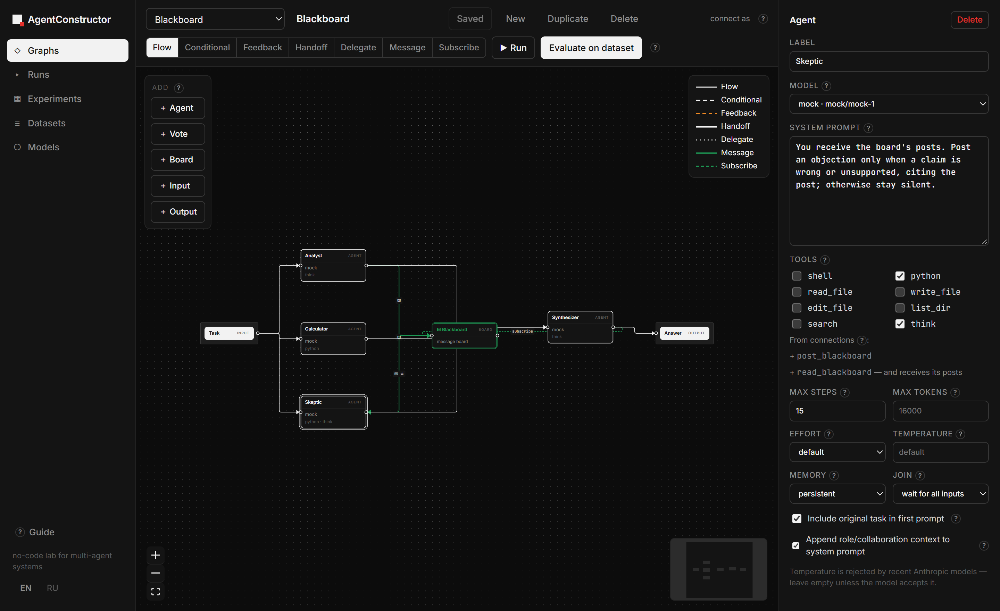
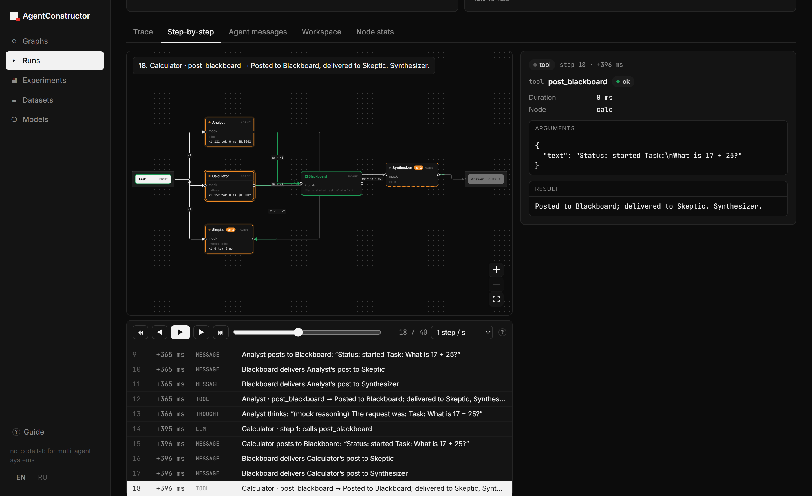
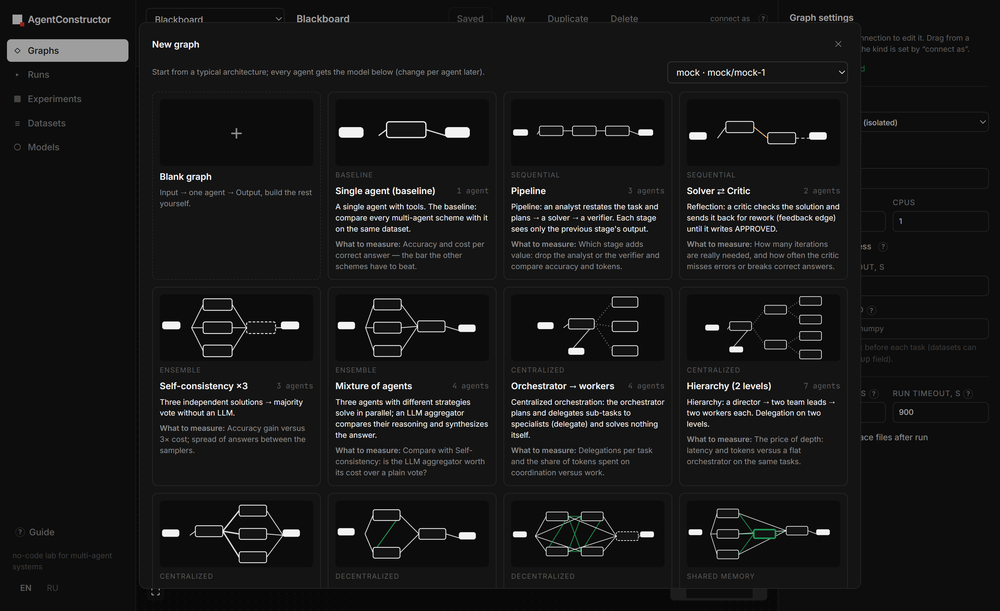
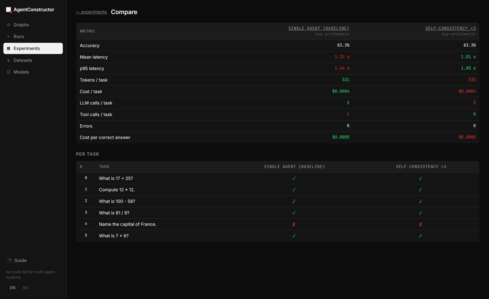

# AgentConstructor

No-code лаборатория для сборки мультиагентных систем в виде графов и исследования их поведения и
эффективности: точность на датасете, время, токены, стоимость, полные трейсы взаимодействий.

[English version](README.md)



| Пошаговый replay | Шаблоны архитектур | Сравнение экспериментов |
|---|---|---|
|  |  |  |

```
backend/   FastAPI + SQLite: провайдеры моделей, песочницы, движок графа, трейсинг, эксперименты
frontend/  React + React Flow: редактор графа, трейсы, эксперименты, сравнение
data/      создаётся при запуске: SQLite-база и рабочие каталоги прогонов (workspaces/<run_id>)
```

## Запуск

Нужны Python 3.11+, Node.js 18+ и Docker для изолированных песочниц (рекомендуется).

```powershell
./start.ps1          # Windows
./start.sh           # macOS / Linux
```

Открыть http://localhost:8000. При первом старте создаются mock-модель (работает без ключей),
тестовый датасет и по одному примеру графа на каждый шаблон архитектуры. Переключатель **EN / RU**
под кнопкой Guide меняет язык подсказок и руководства.

## Понятия

**Узлы**
| Тип | Что делает |
|---|---|
| Input | отдаёт текст задачи при старте прогона |
| Agent | LLM + цикл инструментов; модель, системный промпт, набор инструментов, лимит шагов, effort, память (persistent / fresh), join (all / any). Ход заканчивается, когда модель отвечает без вызова инструментов — этот ответ и есть выход агента |
| Vote | без LLM: мажоритарное голосование по входящим ответам (self-consistency, ансамбли) |
| Board | доска сообщений: агенты пишут в неё, подписчики получают посты |
| Output | последний полученный ответ — итог прогона, он и оценивается |

**Связи**
| Тип | Семантика |
|---|---|
| Flow | выход источника передаётся получателю |
| Conditional | передаётся, если выход удовлетворяет условию (contains / not contains / regex) |
| Feedback | обратная связь, может образовывать циклы; ограничена `max_iterations` |
| Handoff | у агента появляется инструмент `handoff_to_<target>`; управление передаётся, только если агент его вызвал |
| Delegate | у агента появляется инструмент `ask_<target>`: получатель выполняется как под-агент, его ответ возвращается как результат инструмента |
| Message | у агента появляется `message_<target>`: писать другому агенту в любой момент, не заканчивая ход. Флаг «Two-way» даёт обратный инструмент получателю. Связь к доске даёт `post_<board>` |
| Subscribe | агент ↔ доска: агент получает новые посты доски — от всех или только от выбранных авторов (`authors`); остальные посты он может прочитать через `read_<доска>` |

Планировщик — dataflow: агент с `join=all` ждёт, пока все его предки закончат, и обрабатывает все
входящие сообщения разом; параллельные ветки выполняются одновременно. Прямые сообщения и посты
доски асинхронны: если получатель сейчас работает, сообщение попадает ему перед следующим вызовом
модели (событие `inject` в трейсе), если свободен — он запускается. Агенты, связанные с доской,
получают также `read_<board>` — прочитать её историю. Всё, что агент получил из связей, видно в
инспекторе узла («From connections»), а редактор на лету проверяет граф (ошибки и предупреждения
в настройках графа).

**Инструменты агентов** (всё выполняется в песочнице прогона): `shell`, `python`, `read_file`,
`write_file`, `edit_file`, `list_dir`, `search` (regex по файлам), `think` (для моделей без
встроенного рассуждения).

**Рассуждения в трейсе.** Мысли агента записываются автоматически как события `thought`: и вызовы
`think`, и встроенное рассуждение модели. Для Claude 5.x сервер запрашивает краткие пересказы
рассуждения (`thinking.display = "summarized"`) — на поведение и стоимость это не влияет, у этих
моделей мышление и так включено; для старых моделей ничего не меняется. У OpenAI-совместимых
серверов сохраняется `reasoning_content` / `reasoning`, если сервер их отдаёт (vLLM, DeepSeek,
OpenRouter).

**Песочницы.** У каждого прогона свой каталог `data/workspaces/<run_id>`, общий для всех агентов прогона.
- `docker` (по умолчанию): контейнер `python:3.12-slim`, каталог смонтирован в `/workspace`, сеть
  выключена, ограничения CPU / памяти / процессов. Если Docker не запущен, прогон завершается ошибкой
  (тихого отката на хост нет).
- `local`: процесс на хосте с `cwd` = workspace и вычищенными из окружения секретами. Файловые
  инструменты не выпускают за пределы workspace, но shell-команды **не изолированы**.

**Провайдеры:** OpenAI, Anthropic, OpenRouter, vLLM, Ollama (последние три — через
OpenAI-совместимый API), Mock. Ключ можно указать в модели или в переменных окружения
`OPENAI_API_KEY`, `ANTHROPIC_API_KEY`, `OPENROUTER_API_KEY`. Для Anthropic по умолчанию включены
prompt caching и серверный refusal fallback (`fallbacks: "default"`); если запрос обслужила другая
модель, это видно в трейсе («served by»). Для строгих сравнений моделей fallback можно выключить. vLLM по умолчанию тоже занимает порт 8000 —
запустите один из серверов на другом порту (`PORT=8080 ./start.sh` или `vllm serve … --port 8001`).

## Шаблоны архитектур

**New** в редакторе открывает галерею типичных схем; всем агентам назначается выбранная модель
(потом её можно поменять у каждого агента). Те же графы при первом запуске добавляются в список
как примеры на mock-модели.

| Группа | Шаблон | Что это |
|---|---|---|
| Baseline | Single agent | один агент с инструментами — точка отсчёта для остальных схем |
| Sequential | Pipeline | аналитик → решатель → верификатор по стрелкам `flow` |
| | Solver ⇄ Critic | критик возвращает решение на доработку (`feedback`), пока не APPROVED |
| Ensemble | Self-consistency ×3 | три независимых решения → голосование без LLM |
| | Mixture of agents | три агента с разными стратегиями → LLM-агрегатор |
| Centralized | Orchestrator → workers | координатор только раздаёт подзадачи (`delegate`) и собирает ответ |
| | Hierarchy (2 levels) | директор → два тимлида → исполнители (`delegate`, глубина 3) |
| | Router (handoff) | диспетчер передаёт управление одному специалисту (`handoff`) |
| Decentralized | Debate + judge | два агента спорят через двустороннюю связь `message`, судья выносит вердикт |
| | Swarm | четыре равных агента, только двусторонние связи `message`, итог — голосование |
| Shared memory | Blackboard | специалисты публикуют находки на доску, подписанный скептик (`subscribe`) оспаривает ошибки, синтезатор отвечает |
| | Team chat + board | лид переписывается с исследователем напрямую и подписан на доску, куда кодер публикует расчёты |

У каждого шаблона в галерее подсказано, что на нём стоит измерять (например, для роя — объём
переписки против прироста точности и сходятся ли агенты к одному ответу). Через MCP шаблоны доступны инструментами
`list_templates` и `create_graph_from_template`, по REST — `GET /api/templates` и
`POST /api/graphs/from-template`.

## Датасеты

JSONL, JSON-массив или CSV. Поле задачи: `task | question | input | prompt | problem | query`,
ответа: `answer | expected | output | target | solution | reference | label`. Дополнительно:

```json
{"task": "Почини calc.py, чтобы тесты прошли. Ответь DONE.", "answer": "DONE",
 "files": {"calc.py": "def add(a, b):\n    return a - b\n"}, "setup": "pip install -q pytest"}
```

`files` записываются в песочницу перед прогоном, `setup` выполняется там же.

Вместо содержимого в `files` можно указать папку на этой машине — она копируется в песочницу при
старте каждого прогона:

```json
{"task": "…", "answer": "DONE", "files": "C:/bench/repo1"}
{"task": "…", "answer": "DONE", "files": "C:/bench/repo1", "files_glob": "**/*.py; !**/__pycache__/**"}
{"task": "…", "answer": "DONE", "files": {"dir": "C:/bench/repo1", "glob": ["src/**", "*.toml"]}}
```

- **Шаблоны** (`files_glob` или `glob`; несколько — через `;` или списком): без `/` — по имени
  файла на любой глубине (`*.py`), с `/` — путь от корня папки (`src/**/*.ts`, `**` — любые
  подкаталоги), `re:<regex>` — регулярное выражение по относительному пути, `!` в начале —
  исключение. Без шаблона копируется вся папка.
- **Относительные пути** считаются от папки файла датасета (импорт через MCP) или от корня проекта.
  В пути можно подставлять поля задачи: `tasks/{id}`.
- **Папка для всего датасета:** при загрузке на странице Datasets заполните поля «Files folder» и
  «Glob» (в MCP — `files_dir` / `files_glob`). Они применяются к задачам без собственного `files`.
- В CSV путь пишется в колонку `files`, шаблон — в колонку `files_glob`.
- Папка и шаблон проверяются при загрузке: если папки нет или шаблону не соответствует ни один файл,
  загрузка не пройдёт. Лимит — 5000 файлов / 200 МБ на задачу. В трейсе (спан sandbox) сохраняются
  список скопированных файлов, их размер и хэш содержимого, так что видно, если папка изменилась
  между экспериментами.

**Оценка:** `auto` (число → числовое сравнение, иначе точное совпадение / вхождение), `exact`,
`contains`, `numeric`, `regex`, `llm_judge` (выбранная модель сравнивает с эталоном; её стоимость
считается отдельно), `none`. Ответ извлекается из последнего `<answer>…</answer>` или строки
`Final answer: …`.

## Что измеряется

На прогон: длительность, входные / выходные / кэшированные токены, стоимость, число LLM-вызовов,
вызовов инструментов и активаций агентов, а также та же статистика по каждому узлу. Трейс — дерево
спанов `run → sandbox / node → llm / tool / delegate`, плюс события `message` (доставка по связи),
`vote`, `limit`. В LLM-спане видно, что модель получила нового с прошлого шага, её ответ, вызовы
инструментов и reasoning (если провайдер его отдаёт).

В деталях активации агента и каждого LLM-шага показан системный промпт, который действовал в этот
момент (вместе с автоматически дописанным контекстом), и набор предложенных инструментов.

**Step-by-step** (вкладка на странице прогона) воспроизводит прогон на графе по шагам: старт и
завершение активаций, ответы модели, вызовы инструментов, доставку сообщений по стрелкам. Узлы
окрашиваются по состоянию на текущем шаге (ждёт сообщений / работает / готово / ошибка) и показывают
накопленные токены и стоимость; пройденные стрелки помечены счётчиком. Навигация: `←` `→`, `Space`
(автовоспроизведение, в том числе в реальном времени), `Home` / `End`, ползунок и список шагов.
Наведение на узел или стрелку показывает их состояние на этом шаге, клик закрепляет узел.

Для новичков: окно **Guide** (слева внизу, открывается само при первом запуске) с чек-листом, который
отмечается по реальному прогрессу, и подсказки «?» у всех настроек.

На эксперимент: accuracy, среднее / медиана / p95 времени, токены и стоимость на задачу, стоимость
правильного ответа, ошибки, вклад каждого агента. Повторы (`repeats`) нужны для оценки разброса.
Страница Compare сравнивает эксперименты по метрикам и по каждой задаче. Экспорт: CSV / JSONL
по эксперименту, JSON с полным трейсом по прогону.

## MCP: настройка из Claude Code и аналогов

Сервер отдаёт MCP по streamable HTTP на `http://localhost:8000/mcp`. В этом репозитории уже лежит
`.mcp.json`: Claude Code, запущенный в папке проекта, предложит подключить сервер сам. Для других
мест:

```bash
claude mcp add --transport http agentconstructor http://localhost:8000/mcp
```

Инструменты: `overview` (схема графа и датасета — с него стоит начинать), `list_models`,
`add_model`, `test_model`, `list_graphs`, `get_graph`, `list_templates`, `create_graph_from_template`, `save_graph` (с проверкой графа; некорректный
граф не сохраняется), `delete_graph`, `list_datasets`, `get_dataset`, `create_dataset`,
`add_dataset_items`, `import_dataset_file` (локальный JSONL / JSON / CSV), `delete_dataset`,
`run_task`, `get_run` (трейс в виде таймлайна), `start_experiment`, `get_experiment`
(с ожиданием завершения), `list_experiments`, `compare_experiments`, `cancel`.
API-ключи моделей через MCP не возвращаются.

## API

Всё, что делает UI, доступно по REST (`/docs` — Swagger): `/api/models`, `/api/graphs`,
`/api/graphs/validate`, `/api/templates`, `/api/graphs/from-template`, `/api/datasets`, `/api/runs`, `/api/experiments`, `/api/runs/{id}/export`,
`/api/experiments/{id}/export?format=csv|jsonl`.

## Разработка

```bash
python -m venv .venv && .venv/bin/pip install -r backend/requirements-dev.txt
cd backend && ../.venv/bin/python -m uvicorn app.main:app --reload --port 8000   # API + собранный UI
cd frontend && npm install && npm run dev                                         # UI с hot reload на :5173
cd backend && ../.venv/bin/python -m pytest                                       # тесты (mock-модель, без ключей и Docker)
```

`AGENTCONSTRUCTOR_DATA` переносит базу и рабочие каталоги в другую папку. Как устроен проект и как
добавить провайдера, инструмент или шаблон — в [CONTRIBUTING.md](CONTRIBUTING.md).

## Безопасность

AgentConstructor — локальный исследовательский инструмент: сервер слушает только `127.0.0.1`, **не
имеет аутентификации**, хранит API-ключи в локальной SQLite-базе и позволяет агентам выполнять код.
Не открывайте его в недоверенную сеть и используйте Docker-песочницу. Подробнее — [SECURITY.md](SECURITY.md).

## Лицензия

[MIT](LICENSE)
